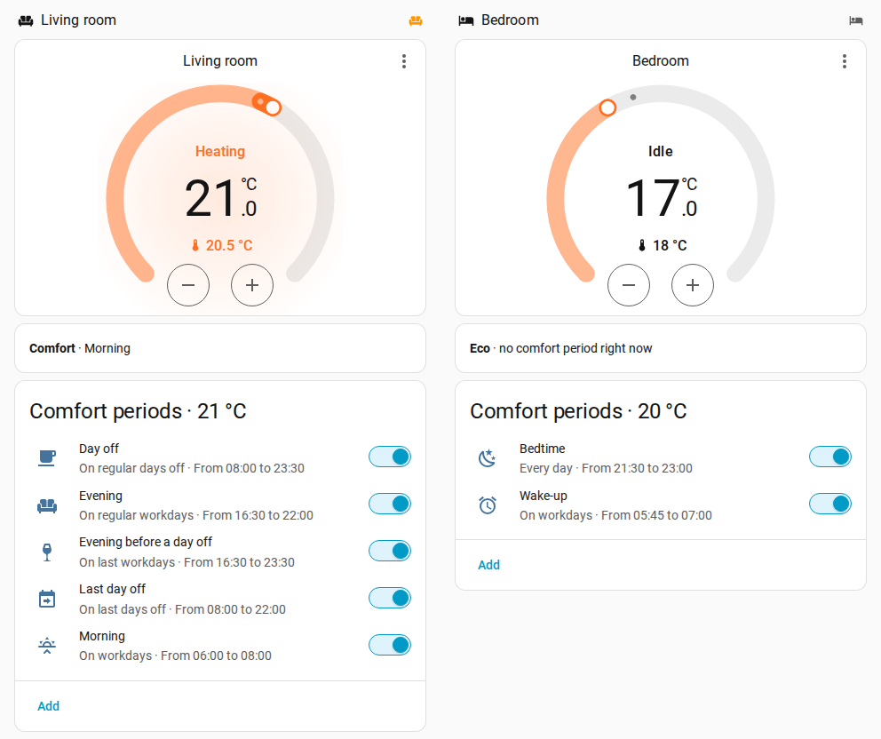
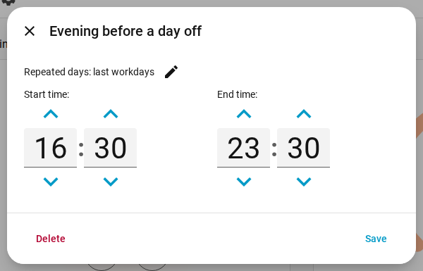
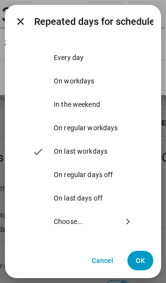
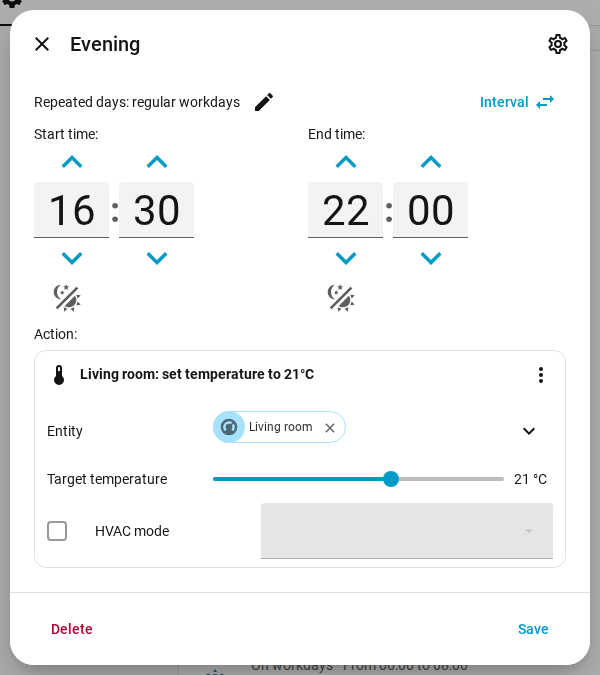

# Scheduler for everyday use

*A working concept for [Scheduler Card](https://github.com/nielsfaber/scheduler-card) and [Scheduler Component](https://github.com/nielsfaber/scheduler-component)*

Scheduler runs the heating, lights and irrigation in many homes. The extensions described here make it work for a second group of people as well: household members who want to change *when* things happen, but not *what* happens.

Everything below already runs in Home Assistant. Each part has its own issue or pull request, and the configuration used for the screenshots is [included](#try-it-yourself).

## Setting up schedules and living with them

These are two different jobs.

- The person who sets up the house picks entities, actions, conditions and temperatures.
- Everyone else wants to start the morning heating half an hour earlier, or keep the living room warm a bit longer on Friday evening.

Today one editor serves both. A household member who opens a schedule sees entities, services, options and editor modes, and can change or delete the logic behind it by accident. In practice, one person ends up editing every schedule for everyone.

Similar needs have come up in the [Scheduler thread](https://community.home-assistant.io/t/scheduler-card-custom-component/217458) over the years (e.g. posts [#81](https://community.home-assistant.io/t/scheduler-card-custom-component/217458/81), [#135](https://community.home-assistant.io/t/scheduler-card-custom-component/217458/135), [#2051](https://community.home-assistant.io/t/scheduler-card-custom-component/217458/2051), [#2113](https://community.home-assistant.io/t/scheduler-card-custom-component/217458/2113)), this brings them together.

## One setup, simple dashboards

The dashboard designer decides what each card shows. Household members get a dashboard built for one purpose, where they can only change what is theirs to change. Nothing changes for existing cards: all options are opt-in.

### Example: heating



- Each room shows its thermostat, whether a comfort period applies right now, and its list of comfort periods.
- The periods have names and icons, and they follow the household's rhythm: workdays, the evening before a day off, days off, the last day off before work. Public holidays come from the Workday integration.
- Outside a comfort period, the room goes back to eco. That rule is the designer's automation. It is based on whether a schedule of the room is currently active, so nobody has to keep a template in sync with the schedules.



Editing a period means choosing the days, a start time and an end time. The card fixes the action (21 °C in the living room), so it can't be changed or lost. New periods get the same action and the room's tag automatically.



The day choices follow the household's week, not only the calendar.



The designer manages the same schedules in the full editor, here in the new interval mode: one start and one end time, with the action and options.

The same pattern fits lighting, irrigation, appliances and other recurring tasks.

<details>
<summary>Card configuration of the living room</summary>

```yaml
type: custom:scheduler-card
title: Comfort periods · 21 °C
include:
  - climate.living_room
tags: heating_living_room
default_editor: interval
default_actions:
  - service: climate.set_temperature
    entity_id: climate.living_room
    service_data:
      temperature: 21
show_actions: false
show_options_tab: false
show_editor_mode_button: false
show_sun_mode_button: false
display_options:
  primary_info: "{name}"
  secondary_info: "{days} · {time}"
  icon: schedule
```

</details>

## What it brings

**Household members** can adjust their own schedules from a phone or a wall tablet, in their own words ("Evening before a day off"), without learning how the automation works.

**Dashboard designers** keep the logic in one place, stop doing schedule edits for others, and don't need to duplicate schedules in templates or helper automations.

**Scheduler** stays as flexible as it is today. All options are optional, the default behaviour doesn't change, and existing schedules and configurations keep working. Each part can be accepted on its own.

## Building blocks

| What it gives | Card | Component |
|---|---|---|
| Limited edit mode: hide delete, options and editor switch, lock actions | [#1159](https://github.com/nielsfaber/scheduler-card/issues/1159), PR [#1218](https://github.com/nielsfaber/scheduler-card/pull/1218) | |
| Default actions for new schedules, option to hide actions | [#1225](https://github.com/nielsfaber/scheduler-card/issues/1225) | |
| Choosing the default actions in the visual card editor | [#1231](https://github.com/nielsfaber/scheduler-card/issues/1231) | |
| Limit which tags can be assigned | [#1160](https://github.com/nielsfaber/scheduler-card/issues/1160), PR [#1221](https://github.com/nielsfaber/scheduler-card/pull/1221) | |
| Hide the switch to sun-based times | [#1228](https://github.com/nielsfaber/scheduler-card/issues/1228) | |
| Schedule icons in the list | [#1222](https://github.com/nielsfaber/scheduler-card/issues/1222) | |
| Interval editor (start and end time) | [#1219](https://github.com/nielsfaber/scheduler-card/issues/1219) | |
| Regular and last workdays / days off | | [#562](https://github.com/nielsfaber/scheduler-component/issues/562), builds on PR [#561](https://github.com/nielsfaber/scheduler-component/pull/561) (holidays for future dates) |
| `active` attribute: the schedule applies right now | | [#563](https://github.com/nielsfaber/scheduler-component/issues/563) |
| Show in the list which schedule applies right now | [#1233](https://github.com/nielsfaber/scheduler-card/issues/1233) | uses [#563](https://github.com/nielsfaber/scheduler-component/issues/563) |

Two larger proposals are not part of the working setup yet:

- a card for editing a single schedule directly in a room dashboard ([card #1220](https://github.com/nielsfaber/scheduler-card/issues/1220)),
- optional exit actions for timeslots with an end time ([component #564](https://github.com/nielsfaber/scheduler-component/issues/564)).

The issues contain the detailed specifications. This document only shows how the parts fit together.

## How the code is kept

Each feature and fix lives in its own branch, based on the upstream main branch. The forks ([card](https://github.com/ZAK0LA/scheduler-card), [component](https://github.com/ZAK0LA/scheduler-component)) combine them in an `integration` branch. A script rebuilds that branch from a [manifest](card.manifest) whenever upstream changes.

This means:

- any part can be reviewed and merged on its own, as far as its dependencies allow,
- the forks follow upstream continuously,
- the small adjustments needed to combine features stay in the fork and never end up in upstream pull requests,
- the upstream projects don't need to change anything in how they work.

## Try it yourself

The screenshots come from a test Home Assistant with this configuration:

- [`vision/heating-package.yaml`](vision/heating-package.yaml): comfort sensors based on the `active` attribute, the eco automation, and a script that creates the sample schedules,
- [`vision/heating-dashboard.yaml`](vision/heating-dashboard.yaml): the dashboard, with a view for household members and one for the designer.

They need the `integration` branches of both forks and the Workday integration. Schedules that use the new day choices (regular and last workdays / days off) are not valid for the upstream component, so try this on a test instance first.

## Feedback

Feedback is welcome in the [Scheduler thread on the Home Assistant community forum](https://community.home-assistant.io/t/scheduler-card-custom-component/217458).

For the maintainer (Niels, [@neliss](https://community.home-assistant.io/u/neliss) on the forum):

- Does this direction fit your vision for Scheduler?
- Which parts would you consider for upstream?
- Do you see architectural or maintenance concerns that should be addressed first?

For users: if you would use something like this, which part matters most to you?

I'm happy to adapt the implementations, split them into focused pull requests, and add tests and documentation. I don't expect everything to be accepted.

Thank you, Niels, for maintaining Scheduler.
